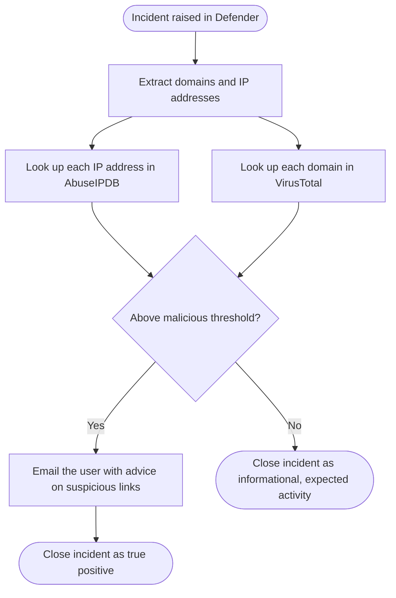

## Why automate incident handling

We get a _lot_ of incidents. Tens of thousands of users and thousands of endpoints, plus a busy guest network, will do that.

When I arrived, the incident queue was unmanageable. We then went through a phase of rough-and-ready PowerShell scripts run by hand. Now we're heading towards a manageable workload, with suppression rules and Logic Apps that fire as soon as Defender raises an incident.

It's not a panacea. Some incidents still need manual investigation. But the team can now see the light and spend more time on strategic work with about 50% of our incidents handled completely automatically.

## How it's set up

Automation rules in Defender trigger different actions or Logic Apps depending on the incident. They run in this order:

1. Automatically close incidents we're not worried about. This uses native Defender processing, not a Logic App.
2. Handle specific incident types with dedicated Logic Apps.
3. Post details of anything still open to a shared Teams channel for manual processing. We no longer need to look into the security portal to determine what needs handling.

## Example: computer connected to a newly registered domain

### Trigger

A custom detection rule finds computers that have connected to a domain registered in the last seven days. It runs twice a day, and if it finds anything it raises an incident in Defender.

```kql
let nrd_domains = externaldata(RawLine: string) [
        h"https://gitlab.com/hagezi/mirror/-/raw/main/dns-blocklists/domains/nrd7.txt"
    ]
    with (format="txt")
    | where isnotempty(RawLine) and not(RawLine startswith "#")
    | project DomainName = tolower(trim(@"\s+", RawLine));
// 2. One latest identity record per SID
let LatestIdentityAccountInfo =
    IdentityAccountInfo
    | where TimeGenerated > ago(25h)
    | where isnotempty(Sid)
    | summarize arg_max(TimeGenerated, *) by Sid
    | project
        Sid,
        IdentityLastSeen = TimeGenerated,
        IdentityAccountUpn = AccountUpn,
        IdentityDisplayName = DisplayName,
        IdentityDepartment = Department,
        IdentityJobTitle = JobTitle,
        IdentityEmailAddress = EmailAddress;
// 3. Find connections to domains in the blocklist and enrich with identity data
DeviceNetworkEvents
| where TimeGenerated >= ago(1d)
| where ActionType == "ConnectionSuccess"
| where isnotempty(RemoteUrl)
| extend DomainName = tolower(RemoteUrl)
| join kind=inner hint.strategy=broadcast nrd_domains on DomainName
| project
    TimeGenerated,
    DeviceName,
    DeviceId,
    ActionType,
    DomainName,
    RemoteIP,
    InitiatingProcessFileName,
    ReportId,
    InitiatingProcessAccountName,
    InitiatingProcessAccountSid
| lookup kind=leftouter LatestIdentityAccountInfo
    on $left.InitiatingProcessAccountSid == $right.Sid
| order by TimeGenerated desc
```

With thanks to [https://github.com/hagezi/dns-blocklists](https://github.com/hagezi/dns-blocklists) for the work producing the lists of newly registered domains.

### The Logic App



The Logic App takes each domain and IP address from the incident and checks it against [VirusTotal](https://www.virustotal.com) and [AbuseIPDB](https://www.abuseipdb.com). We treat a result as malicious if virustotal has any malicious results or more than 4 suspicious results and an IP adress is malicious if the abuseIPDB score is above 30. These need tuning for your environment but work for ours.

If anything crosses the threshold, the user gets an email. It explains why they've received it, gives advice on suspicious links, and tells them how to contact us if they're worried. The incident is then closed as a true positive. If the virus scan detects anything else then we get an alert on that and investigate manually. The incident remains available against the device and user should we need to know more.

If nothing crosses the threshold, the incident is closed as *informational, expected activity*. The connection was real, but it wasn't malicious.


## What went well

Users get targeted security advice at the moment it's relevant, rather than in an annual awareness session they've forgotten by lunchtime.

Benign connections are dealt with automatically, but the incident record remains in case something later turns out to be malicious.

It was also a fun one to build. It combines external threat intelligence lookups with an external data source in a custom detection rule.

## What didn't go so well

The key lesson came from an HTTP `429`: too many requests. The free API tiers have tight rate limits. When the detection rule ran hourly, a busy run could exceed them. I dialled the rule back to twice a day to stay within the limits.

That fix has a cost. Up to 12 hours can now pass between a user visiting a dodgy domain and getting advice about it. Next time I'd keep the hourly schedule and reduce the number of lookups instead:

- Deduplicate domains within each run, so each one is checked once however many devices visited it.
- Cache recent results in a watchlist or table and skip anything checked in the last few days.
- Turn on the Logic App's retry policy with exponential backoff, and limit For each concurrency to 1.

Lesson learnt: check the rate limits before you design the schedule, not after.