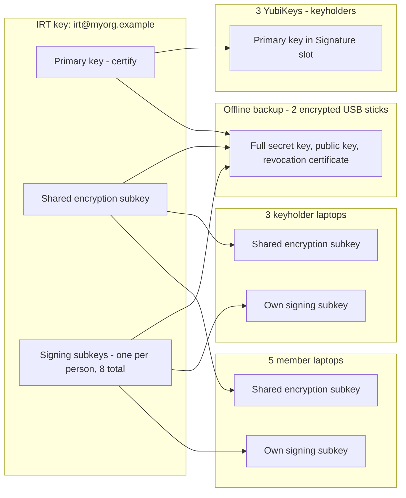

As a lead CSIRT member for my organisation, it was a little embarrassing when we lost control of our PGP keys which are used to decrypt and sign messages to and from our irt email address. But with every embarrassment comes opportunity.

We previously used one set of keys distributed by USB stick to everyone who needed them. This is _OKish_ but has drawbacks:

- The full key exists on many laptops
- When someone leaves the entire key can leave with them
- Anyone with the key can create subkeys
- Anyone with the key can keep a "home backup"

So the opportunity is there to make things better. We created a new key, had it signed by our parent organisation and revoked the old key. We did that quickly, then we had to work out how best to use the new key.

These are the notes for myself and others on how we did it.

## The requirement

Our requirements revolve around the fact that our keys really aren't used very much. The main users will use the key less than once a month, perhaps less than once a year. So it has to be easy to use.

We need one PGP key for irt@myorg.example that:

- **8 team members** can use to decrypt anything sent to the team address and to sign as the team
- only **3 keyholders** can manage: add and revoke subkeys, extend expiry, certify other keys
- keeps the fingerprint of our new key, and the external certification that goes with it
- lets us remove one person's access without disrupting everyone else

We also have a diverse team of users:

- Mac, Windows and Linux users
- Mainly Outlook (Mac, Windows and web) as well as other mail clients
    - Built-in support doesn't exist so we leverage Kleopatra/GPG Suite and command line tools
- Large disparity in technical knowledge and desire to learn

Given this, we have tried to standardise on tools and provide training and practice to every single member of the team so they all know how to achieve their goals.

### The trap: one encryption subkey per person doesn't work

_Why not have an encryption subkey per person as well as a signing key per person? Not all email clients respect this setup and some will only encrypt with the newest encryption subkey that is listed. This would leave only one person in the team being able to read the message. Given we work in shifts and everyone needs to be able to read every message, this is another design choice we had to live with._

## The solution

With these decisions and technical limitations, we came up with a key architecture:

- **Primary key (certify only):** on the 3 keyholders' YubiKeys, plus two offline backups. Never on a laptop (after initial creation).
- **One shared encryption subkey:** on all 8 laptops, so everyone can read team mail.
- **One signing subkey per person:** on that person's laptop, so anyone can be revoked on their own.

| Capability | Keyholders (3) | Members (5) |
|---|---|---|
| Decrypt mail to irt@myorg.example | Yes (laptop) | Yes (laptop) |
| Sign as irt@myorg.example | Yes (own subkey, laptop) | Yes (own subkey, laptop) |
| Add, revoke or extend subkeys | Yes (YubiKey + PIN + touch) | No |
| Certify other keys | Yes (YubiKey + PIN + touch) | No |

### Why YubiKeys for the primary key

As an organisation, we haven't really used hardware tokens much before. But the need to rework our PGP usage coincided with a need for stronger authentication with our main authentication provider. For that solution, [YubiKey](https://www.yubico.com/)s were chosen, so with hardware tokens already procured, we were able to take advantage of other features and had an easy choice for our PGP solution.

What does the YubiKey offer?

- Stores the primary key securely. It can't be copied off the token
- PIN and touch required to use the keys stored on the token
- Easy management, when a keyholder leaves they just need to hand back the token and we can be _sure_\* that the key has been returned

\* _sure_ assuming there haven't been any more vulnerabilities in the hardware token that allow extraction

This is for the full keyholders only. People who only need to be able to read and sign messages can have that on their laptops. This aids ease of use at the price of lower security.

### Why an offline backup as well

One of the main points of using a hardware token like the YubiKey is that once moved to the token, the keys can't be removed. This is great for our purpose as the keyholders can carry the key around with them and if the token is lost it's secure (as secure as the PIN).

That PIN locks after three wrong tries. The Admin PIN can unlock it, but three wrong Admin PIN tries and the only way back is a factory reset, which wipes the key. Then we’re down to two copies.

If the next token gets broken, we are then down to one copy of the key. 

We would no longer be able to create another one from the hardware token. And if another keyholder leaves without returning the token, we're then [SOL](https://www.urbandictionary.com/define.php?term=SOL).

Perhaps a more likely scenario is a firmware vulnerability. YubiKey firmware can’t be updated, and we can’t get the keys back off a vulnerable YubiKey to put them on a newer one.

Guarding against this, we have two offline copies of the full key. These are encrypted and held in safes in our premises. The encryption passphrases are held separately by different people. It's a hassle and it needs training and practice, but it gives us the ability to add further keyholders with hardware tokens when we need to.

## Trade-offs

There is one big downside to this setup... 

If someone leaves with their copy of the key, they will still be able to decrypt messages encrypted with the public key. This is a risk that we're willing to live with on the assumption that messages will be sent responsibly to our irt@myorg.example email address and we can remove access to that address for the leaver.

We can't account for every eventuality so this is our design choice.

### Why laptop keys for day-to-day use?

This is an ease of use trade-off. We know that this lowers the security of the entire system, but we need to live with it given the diverse technical knowledge of our users.

## The broad steps

We started from our new key, already signed by our parent organisation. From this we went through the following steps...

1. **Create a full backup.** We're going to be making lots of changes to our key, so backing up first is a good insurance step. The backup is to two USB sticks and is encrypted.
2. **Create the subkeys.** Keep or create the shared encryption subkey, then add one signing subkey per person and record which belongs to whom. GnuPG can't label subkeys, so this record is the only one. We keep ours in a simple spreadsheet.
3. **Back up.** Export the full secret key, public key and revocation certificate to two USB sticks, and check that the backup restores.
4. **Republish the public key.** Keyservers, WKD, the team web page, RFC 2350 document and CSIRT directories. The fingerprint is unchanged.
5. **Build a bundle per person.** Their signing subkey plus the shared encryption subkey, primary key excluded, encrypted to their personal key.
6. **Load the YubiKeys.** Move the primary key onto each YubiKey, using a fresh temporary keyring loaded from the backup each time.
7. **Set up the laptops.** Import the bundle, set a personal passphrase, set the default signing subkey, tighten passphrase caching. Keyholders also connect their YubiKey.
8. **Remove the primary key from the original machine.** Including old backups of the GnuPG folder (Time Machine can get these so don't forget there if you're using a Mac).
9. **Test.** Signing from each person, decryption by everyone, certification from each YubiKey.

## Setting it up

Awww man! This is tricky, fiddly and time consuming. It needs multiple people in the room. It needs testing at every stage. It needs documenting at every stage. It's a lesson in patience but also a lesson in doing quality work and in teamwork.

## Running it

Smooth as peanut butter! We only buy crunchy peanut butter at home and I'm allergic to that. It is _not_ user friendly, especially for those who are infrequent users. But with each message it gets easier.

I send messages to the team saying it's time for lunch as a practice. _Most_ people arrive on time.

We still haven't gotten to sub-key expiry as yet. When we do, we'll have some more fun, I'm sure.

## Lessons learned / closing thoughts

This takes time. Whatever you think you need, double it and then add some. And then double it again. For us with our very infrequent use of the keys, it needs especially good documentation.

I like the overall solution though; it functions well, the drawbacks are obvious and known. What will change in the future is our handling of tokens. Given the industry I work in, I'm sure that hardware tokens will become less of a novelty and more normal. At that point, we can make sure everyone has one and we don't have the blind spot of the laptop being the weak point.